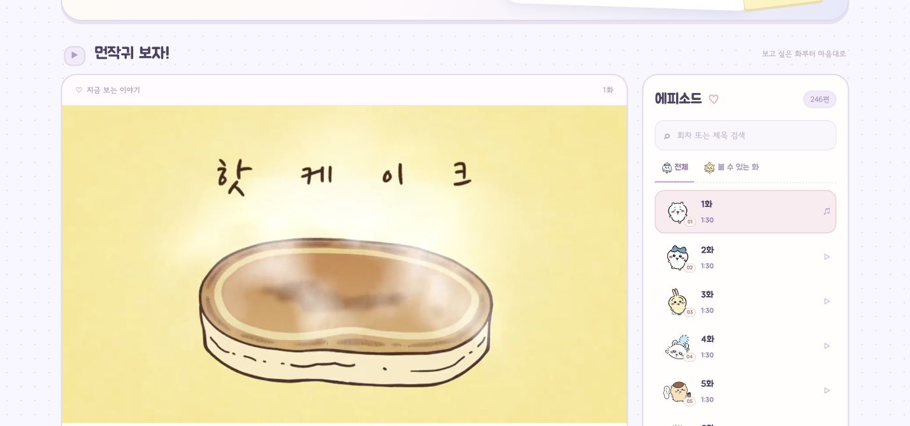

# ChiikawaPlayer · 먼작귀 플레이어

보고 싶은 회차부터 골라 보고, 엔딩은 넘기고 다음 이야기로 이어 보는 먼작귀 웹 플레이어예요.

**[▶ 플레이어 바로 가기](https://chiikawaplayer.161.33.19.71.sslip.io/)**

## 이런 기능이 있어요

- **회차 선택과 검색** — 원하는 회차를 찾고 처음부터 재생해요.
- **엔딩 자동 넘김** — 설정된 엔딩 시간에 맞춰 3초 뒤 다음 회차로 넘어가요. 계속 보고 싶으면 취소할 수 있어요.
- **이전 화·다음 화** — 목록을 다시 찾지 않아도 회차를 바꿀 수 있어요.
- **전체 화면과 모바일 화면** — 컴퓨터와 휴대폰에서 편하게 볼 수 있어요.
- **회원가입 없이 시청** — 공개된 회차는 로그인 없이 볼 수 있고, 시청 기록은 저장하지 않아요.

## 사용 방법

1. **[플레이어](https://chiikawaplayer.161.33.19.71.sslip.io/)**를 열어요.
2. 에피소드 목록에서 보고 싶은 회차를 골라요.
3. 엔딩까지 보고 싶으면 **엔딩 자동 넘김**을 꺼 주세요.

## 이 저장소에 대해

프로젝트 소개와 화면 이미지를 공개하는 저장소예요. 애플리케이션 소스 코드는 별도의 비공개 저장소에서 관리해요.

영상 파일, 관리자 비밀번호, 서버 접속키는 이 저장소에 포함하지 않아요.

## 안내

비공식 개인 프로젝트예요. 캐릭터·이미지·영상의 권리는 각 권리자에게 있으며, 공식 서비스와 관련이 없어요.

무료 서버로 운영하고 있어 접속이 일시적으로 원활하지 않을 수 있어요.
